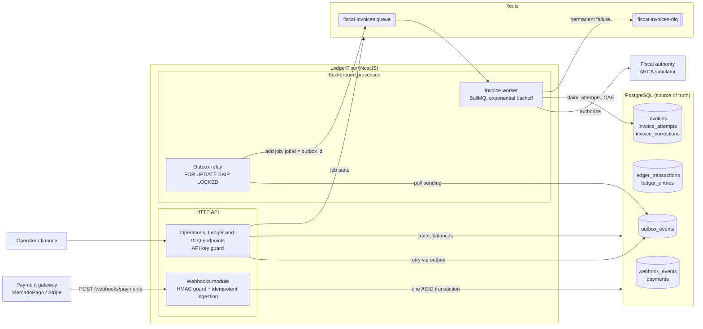
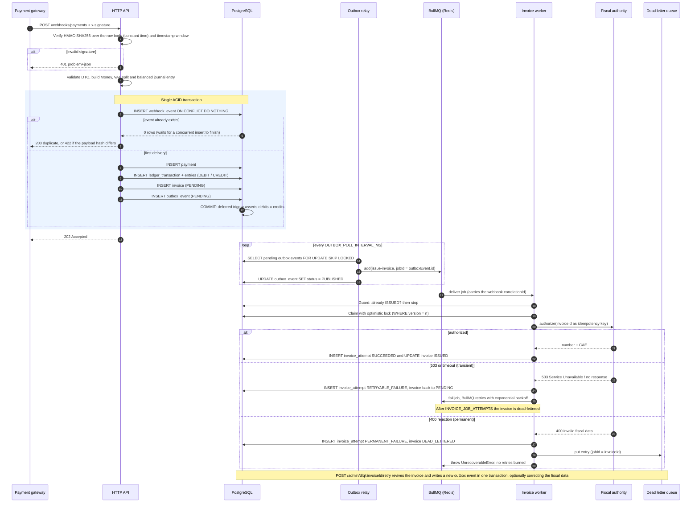
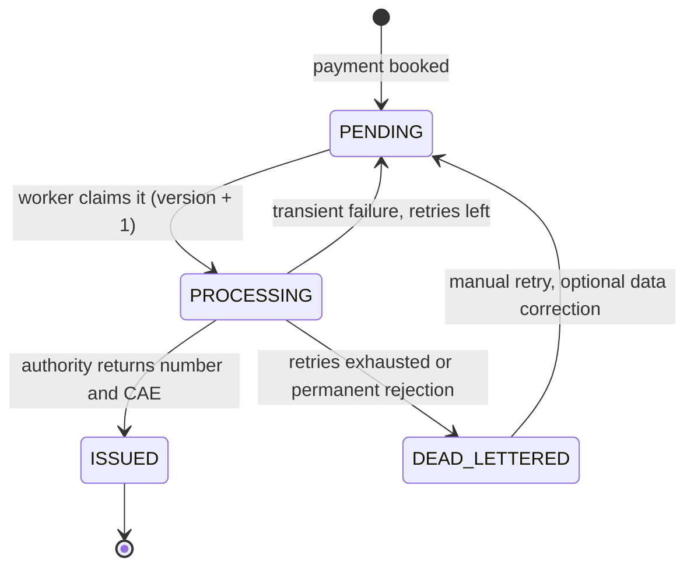
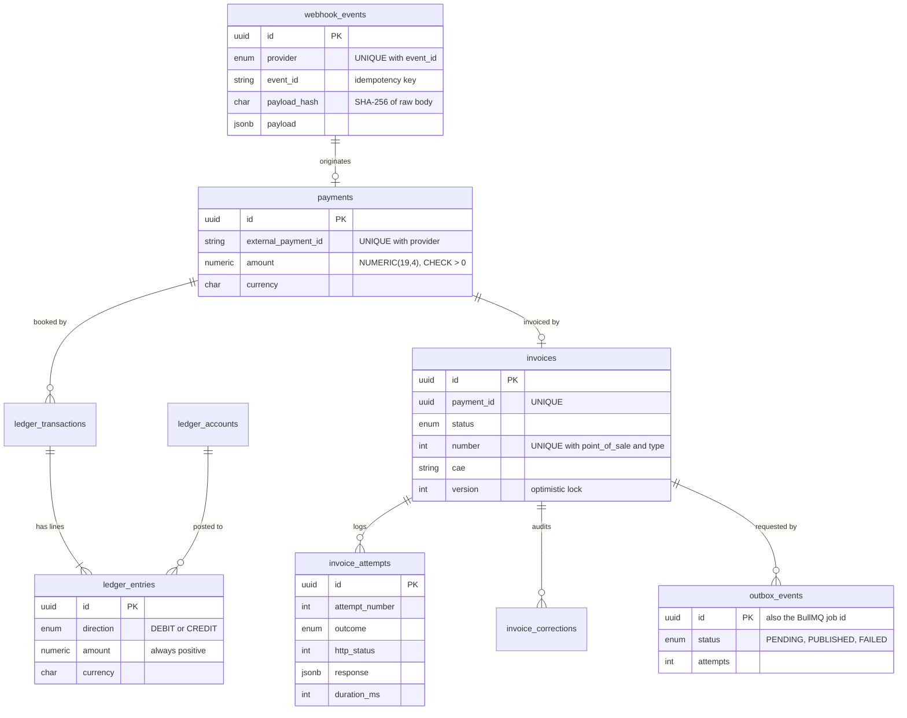

# LedgerFlow

**Asynchronous engine for electronic invoicing and payment reconciliation.**

LedgerFlow receives payment events from gateways such as MercadoPago or Stripe, books each payment exactly once in an immutable double-entry ledger, and issues the corresponding fiscal invoice asynchronously against a tax authority that is slow and unreliable — without ever losing a payment or issuing an invoice twice.

`Node.js 24` · `TypeScript 6 (strict)` · `NestJS 12 (ESM)` · `PostgreSQL 17` · `Prisma 7` · `Redis 7` · `BullMQ 6` · `Jest 30` · `Docker`

---

## Table of contents

- [The problem](#the-problem)
- [Guarantees](#guarantees)
- [Architecture](#architecture)
- [End-to-end flow](#end-to-end-flow)
- [Invoice lifecycle](#invoice-lifecycle)
- [Data model](#data-model)
- [Design decisions and trade-offs](#design-decisions-and-trade-offs)
- [API](#api)
- [Getting started](#getting-started)
- [Walkthrough with curl](#walkthrough-with-curl)
- [Testing](#testing)
- [Configuration](#configuration)
- [Project structure](#project-structure)
- [Limitations and next steps](#limitations-and-next-steps)

---

## The problem

Charging a customer and invoicing that charge are two different operations with very different reliability profiles:

- **Payment gateways deliver webhooks at least once.** The same event can arrive several times, sometimes concurrently. Booking it twice means duplicated revenue in the books and a duplicated invoice sent to the tax authority.
- **Tax authorities are slow and fail often.** In Argentina, an invoice is only valid once ARCA (formerly AFIP) authorizes it and returns a CAE code. That service responds with 503s and timeouts as a matter of routine. Making the gateway wait for it would turn every outage into lost webhooks.
- **A timeout is ambiguous.** When the authority does not answer, the invoice may or may not have been issued. Retrying blindly can produce two legal documents for one sale.
- **Finance needs an audit trail.** "What is the balance?" must be answerable from records that nobody can edit, and every operation must be traceable from the webhook to the authorized invoice.

LedgerFlow answers the webhook in milliseconds, after committing everything that must not be lost, and moves the unreliable part to a background pipeline built to survive crashes at any point.

## Guarantees

| Guarantee                                                             | Mechanism                                                                  |
| --------------------------------------------------------------------- | -------------------------------------------------------------------------- |
| A webhook is booked **exactly once**, even with concurrent duplicates | `INSERT ... ON CONFLICT DO NOTHING` on `UNIQUE (provider, event_id)`       |
| An idempotency key cannot be reused with other content                | SHA-256 of the raw body is stored; a mismatch returns `422`                |
| Only the gateway can post events                                      | HMAC-SHA256 over the raw bytes, constant-time comparison, signed timestamp |
| A booked payment **always** gets its invoice requested                | Transactional outbox: payment and message commit together                  |
| No duplicated jobs after a crash                                      | `jobId = outboxEvent.id`; BullMQ ignores an `add` with an existing id      |
| No invoice is issued twice                                            | Status guard + optimistic locking + idempotent request to the authority    |
| Books always balance                                                  | Deferred constraint trigger checks debits = credits at `COMMIT`            |
| Ledger history cannot be rewritten                                    | Triggers reject `UPDATE`, `DELETE` and `TRUNCATE`                          |
| No floating point in money                                            | `NUMERIC(19,4)` in PostgreSQL, `decimal.js` in code, strings on the wire   |
| Failures are never silent                                             | Every attempt is logged; exhausted or rejected invoices land in a DLQ      |

## Architecture

A single NestJS application plays three roles that can be scaled independently through configuration (`OUTBOX_RELAY_ENABLED`, `INVOICE_WORKER_ENABLED`): HTTP API, outbox relay and queue worker.



Each module follows a pragmatic hexagonal layout: a `domain` of pure functions and value objects, an `application` layer of use cases that depend only on ports (abstract classes), and `infrastructure` / `presentation` adapters for Prisma, BullMQ and HTTP. Use cases are plain classes with no framework decorators, wired in the module through factories, so they are unit-tested with in-memory fakes.

## End-to-end flow



## Invoice lifecycle



Every transition is a conditional `UPDATE ... WHERE version = ?`. A check constraint guarantees that `number`, `cae`, `cae_expires_at` and `issued_at` are present if and only if the status is `ISSUED`.

## Data model



Primary keys are UUID v7: time-ordered, so inserts stay local in B-tree indexes. The invariants that Prisma cannot express — check constraints, append-only triggers and the deferred balance trigger — live in a hand-written SQL migration, so they hold for any client of the database, not only for this application.

## Design decisions and trade-offs

### Idempotency: a PostgreSQL constraint instead of a distributed lock in Redis

The usual approach is `SET key NX` in Redis before processing. It was rejected because it creates a second source of truth that can disagree with the database: the lock can expire while the transaction is still running, Redis can be unavailable or lose the key in a failover, and the lock and the business data never commit atomically.

Instead, the idempotency key is a unique constraint in the same transaction as the data it protects. `INSERT ... ON CONFLICT DO NOTHING` has exactly the semantics needed: if another transaction has inserted the same key and not yet committed, the statement **waits**; if that transaction commits, nothing is inserted (duplicate); if it rolls back, this one wins. There is no check-then-act window, and no cleanup or TTL to tune.

- **Cost:** every request reaches PostgreSQL; there is no cheap rejection at the edge. A Redis lookup could be added later as a fast path, strictly as an optimization, with the constraint still deciding.
- **Related choice:** the stored hash covers the raw bytes, so the same JSON re-serialized with different whitespace is treated as a different payload (`422`). Strict by design: a real gateway redelivers byte-identical bodies.
- **`422` vs `409`:** `422` means "this key was already used with another payload" (a client bug or an attack); `409` is reserved for a _different_ event that reports an already booked payment.

### Transactional outbox instead of enqueueing from the request

Writing to PostgreSQL and then to Redis is a dual write: a crash between the two leaves a booked payment with no invoice job, forever. The outbox closes that gap by turning the intention to enqueue into a row committed with the payment. A relay publishes it afterwards.

- `FOR UPDATE SKIP LOCKED` lets several relay instances share the work without blocking each other or publishing the same row twice.
- Delivery to the queue is at-least-once, so duplicates must be harmless: the job id is the outbox event id, and BullMQ ignores an `add` whose id already exists. A relay that dies between `queue.add()` and the `UPDATE` simply republishes into a no-op.
- **Poison-pill protection:** an event that can never be published (unknown type, corrupt payload) is marked `FAILED` after `OUTBOX_MAX_ATTEMPTS`. Infrastructure failures such as a Redis outage are deliberately **not** counted: failing valid events during an outage would lose invoices.
- **Cost:** latency of up to one polling interval (1 s by default) and constant light polling. Logical replication (CDC) would remove both at the price of far more operational complexity.

### Immutable double-entry ledger enforced by the database

Balances are never stored or updated; they are derived by summing entries (`GET /ledger/balances`). Corrections are made with reversing entries, not edits.

- **Append-only by trigger.** `UPDATE`, `DELETE` and `TRUNCATE` on the ledger raise an exception. An application-level convention would not survive the first ad-hoc script.
- **Balance checked at commit.** A `DEFERRABLE INITIALLY DEFERRED` constraint trigger verifies, per transaction and currency, that debits equal credits and that the entry has lines. It must be deferred: while the lines are being inserted one by one, the entry is necessarily unbalanced.
- **Defense in depth.** The domain object `JournalEntry` cannot be constructed unbalanced, so the trigger should never fire; it exists for the day a bug or a manual `INSERT` bypasses the domain.
- **Cost:** computing a balance is an aggregation over all entries of an account. Fine at this scale and covered by an index on `(account_id, currency, id)`; a high-volume system would add periodic snapshots.

### Money: `NUMERIC` and `decimal.js`, never `number`

`0.1 + 0.2 !== 0.3` in IEEE 754, and JSON parsers silently turn `12100.10` into a binary float. Therefore:

- amounts travel as **strings** in the API, are stored as `NUMERIC(19,4)` and are computed with `decimal.js` inside a `Money` value object that can only be built from a string;
- `Money` rejects sub-cent precision instead of rounding it, and refuses to mix currencies;
- the VAT split rounds only the net amount (banker's rounding) and obtains the tax by subtraction, so `net + tax = total` holds exactly for every amount — verified by a test that sweeps 5,000 values;
- aggregations run in SQL over `NUMERIC` and are returned as text.

`BigInt` cents were considered: equally exact and faster, but they push the scale into every call site and make currencies with different minor units harder to support.

### Retries, timeouts and the "did it go through?" problem

Errors are classified by whether repeating the request can change the outcome:

| Failure                          | Classification | Behaviour                                                                 |
| -------------------------------- | -------------- | ------------------------------------------------------------------------- |
| `503`, timeout, unexpected error | Transient      | Retry with exponential backoff and jitter (1 s, 2 s, 4 s, 8 s by default) |
| `400` invalid fiscal data        | Permanent      | `UnrecoverableError`: straight to the DLQ, no retries burned              |
| Retries exhausted                | —              | Invoice `DEAD_LETTERED`, entry added to the DLQ                           |

The hardest case is a timeout **after** the authority processed the request: the client sees a failure, the invoice exists. Three layers prevent a second invoice:

1. **Guard.** Before any external call the worker checks the invoice status; an `ISSUED` invoice ends the job immediately. This also absorbs redelivered ("stalled") jobs.
2. **Optimistic locking.** The worker claims the invoice with `WHERE version = ?`. If two jobs race, only one write succeeds.
3. **Idempotent authority request.** The invoice id is sent as an idempotency key; a retry receives the original authorization. The simulator reproduces this fault on purpose (`timeout_after_processing`) and an end-to-end test asserts that the next invoice gets the consecutive number. A real ARCA client would obtain the same property by querying the last authorized voucher before retrying.

The timeout is enforced by the use case with `AbortSignal.timeout` and `Promise.race`, not delegated to the adapter: an attempt ends on time even if an implementation ignores the signal.

### Dead letter queue and manual recovery

The DLQ is a BullMQ queue without consumers, keyed by invoice id. PostgreSQL remains the source of truth (`DEAD_LETTERED`); the queue is a projection that the listing cross-checks.

A manual retry does **not** push a job to Redis directly. It moves the invoice back to `PENDING` and inserts a new outbox event in one transaction, so it inherits the same crash safety as the main flow and is naturally idempotent: of five concurrent retries, one returns `202` and four return `409`.

An invoice rejected for invalid data would fail again unchanged, so the retry accepts a corrected tax id. The correction is validated first (CUIT check digit), then the payer data, the invoice type, an append-only audit record and the outbox event are written atomically. The original webhook payload is never modified.

### Other decisions

- **Ordered shutdown.** Relay and worker stop in `onModuleDestroy`, finishing in-flight work; database and Redis connections close last, in `onApplicationShutdown`. The opposite order makes in-flight jobs fail during every deploy.
- **Correlation id end to end.** Taken from `x-correlation-id` or generated, stored with the event, carried in the job payload and bound to the Pino logging context of the worker through `AsyncLocalStorage`. One id links the HTTP request, the relay and every retry.
- **RFC 7807 everywhere.** A global filter renders every error as `application/problem+json`. Domain errors carry a stable code; the mapping to HTTP status lives in the presentation layer. Unexpected errors never leak internal details.
- **Fail-fast configuration.** Environment variables are validated with `zod` at startup; the process refuses to start with a missing or malformed value.
- **No escape hatches in types.** `strict` TypeScript plus lint rules that forbid `any`, type assertions (`as`), non-null assertions and `@ts-ignore`. External data (HTTP bodies, job payloads, Redis replies) is parsed, not cast.

## API

Interactive documentation is served at **`/docs`** (OpenAPI JSON at `/docs-json`).

| Method | Path                          | Auth                 | Purpose                                                   |
| ------ | ----------------------------- | -------------------- | --------------------------------------------------------- |
| `POST` | `/webhooks/payments`          | `x-signature` (HMAC) | Idempotent ingestion of a payment event                   |
| `GET`  | `/operations/:paymentId`      | `x-api-key`          | Full trace: webhook → ledger → invoice → attempts → queue |
| `GET`  | `/ledger/balances`            | `x-api-key`          | Trial balance derived from ledger entries                 |
| `GET`  | `/admin/dlq`                  | `x-api-key`          | Invoices in the dead letter queue                         |
| `POST` | `/admin/dlq/:invoiceId/retry` | `x-api-key`          | Idempotent manual retry, optionally with corrected data   |
| `GET`  | `/health`                     | —                    | Readiness probe                                           |

**Webhook signature.** `x-signature: t=<unix seconds>,v1=<hex>`, where `v1 = HMAC-SHA256(secret, "<t>." + raw body)`. The timestamp is part of the signed content and must be within `WEBHOOK_TIMESTAMP_TOLERANCE_SECONDS` (300 by default) of the server clock.

**Webhook responses.** `202` first delivery · `200` duplicate or non-accounting event · `400` invalid body · `401` invalid signature · `409` payment already booked by another event · `422` idempotency key reused with a different payload.

## Getting started

### Requirements

- Docker and Docker Compose
- For local development and tests: Node.js 24 and pnpm 12

Commands below use a POSIX shell (Linux, macOS, WSL or Git Bash on Windows).

### Run everything with Docker

```bash
cp .env.example .env
# Recommended: replace the two placeholder secrets
#   WEBHOOK_SIGNING_SECRET -> openssl rand -hex 32
#   ADMIN_API_KEY          -> openssl rand -hex 24

docker compose up --build
```

This starts PostgreSQL, Redis, a one-shot job that applies the migrations, and the application on <http://localhost:3000>. Open <http://localhost:3000/docs> for the API documentation.

If ports `5432`, `6379` or `3000` are taken, change `POSTGRES_HOST_PORT`, `REDIS_HOST_PORT` or `PORT` in `.env`.

### Run the application on the host

```bash
docker compose up -d postgres redis   # infrastructure only
pnpm install
pnpm prisma:generate
pnpm prisma:migrate:deploy
pnpm start:dev
```

## Walkthrough with curl

Every command in this section was run against the Docker stack. The outputs come from a real run and are shortened where noted; identifiers, invoice numbers and totals will differ on your machine.

### 0. Load the secrets and define a signing helper

```bash
set -a && . ./.env && set +a
BASE=http://localhost:3000

# Builds the x-signature header for a raw body
sign() {
  local ts sig
  ts=$(date +%s)
  sig=$(printf '%s.%s' "$ts" "$1" \
    | openssl dgst -sha256 -hmac "$WEBHOOK_SIGNING_SECRET" -hex | sed 's/^.* //')
  echo "t=$ts,v1=$sig"
}
```

### 1. Send a signed payment webhook

The body is kept in a variable so that the bytes that are signed are exactly the bytes that are sent.

```bash
BODY='{"eventId":"evt_demo_001","provider":"MERCADOPAGO","type":"payment.approved","data":{"paymentId":"pay_demo_001","amount":"12100.00","currency":"ARS","payer":{"name":"Juan Perez","taxId":"30111222"},"description":"Pro plan"}}'

curl -i -X POST "$BASE/webhooks/payments" \
  -H 'content-type: application/json' \
  -H "x-signature: $(sign "$BODY")" \
  --data-raw "$BODY"
```

```http
HTTP/1.1 202 Accepted
x-correlation-id: dec2868d-4242-4423-9aef-c752cf1d5e14

{
  "status": "accepted",
  "eventId": "evt_demo_001",
  "webhookEventId": "01a1e5f7-0553-75be-af38-4269b1fb50c0",
  "paymentId": "01a1e5f7-0574-7158-9d2b-549b4c55c924",
  "ledgerTransactionId": "01a1e5f7-0585-721e-b726-dd4eb8509029",
  "invoiceId": "01a1e5f7-058d-707a-98fe-0fba7f99af76",
  "correlationId": "dec2868d-4242-4423-9aef-c752cf1d5e14"
}
```

Keep the payment id for the next steps:

```bash
PAYMENT_ID=<paymentId from the response>
```

### 2. Idempotency and signature checks

```bash
# Same event again -> 200, "status": "duplicate", same identifiers, nothing written
curl -s -X POST "$BASE/webhooks/payments" -H 'content-type: application/json' \
  -H "x-signature: $(sign "$BODY")" --data-raw "$BODY"

# Same eventId, different amount -> 422
TAMPERED=${BODY/12100.00/1.00}
curl -s -X POST "$BASE/webhooks/payments" -H 'content-type: application/json' \
  -H "x-signature: $(sign "$TAMPERED")" --data-raw "$TAMPERED"
```

```json
{
  "type": "/problems/idempotency-payload-mismatch",
  "title": "Idempotency key reused with a different payload",
  "status": 422,
  "detail": "Event \"evt_demo_001\" from MERCADOPAGO was already received with a different payload. An idempotency key must always identify the same payload.",
  "instance": "/webhooks/payments",
  "correlationId": "9473d8e7-34b3-4268-95cd-3aff0b6e8f34"
}
```

```bash
# Invalid signature -> 401 "/problems/invalid-webhook-signature"
curl -s -X POST "$BASE/webhooks/payments" -H 'content-type: application/json' \
  -H 'x-signature: t=1,v1=00' --data-raw "$BODY"
```

### 3. Trace the operation

The fiscal simulator fails about 30% of the requests, so the invoice may take a few seconds and several attempts.

```bash
curl -s "$BASE/operations/$PAYMENT_ID" -H "x-api-key: $ADMIN_API_KEY"
```

```jsonc
{
  "correlationId": "dec2868d-4242-4423-9aef-c752cf1d5e14",
  "webhookEvent": { "eventId": "evt_demo_001", "status": "PROCESSED" /* ... */ },
  "payment": { "amount": "12100.00", "currency": "ARS", "status": "APPROVED" /* ... */ },
  "ledgerTransactions": [
    {
      "type": "PAYMENT_CAPTURE",
      "entries": [
        {
          "accountCode": "GATEWAY_RECEIVABLE_MERCADOPAGO",
          "direction": "DEBIT",
          "amount": "12100.00",
          "currency": "ARS",
        },
        {
          "accountCode": "SALES_REVENUE",
          "direction": "CREDIT",
          "amount": "10000.00",
          "currency": "ARS",
        },
        {
          "accountCode": "VAT_PAYABLE",
          "direction": "CREDIT",
          "amount": "2100.00",
          "currency": "ARS",
        },
      ],
    },
  ],
  "invoice": {
    "status": "ISSUED",
    "type": "B",
    "pointOfSale": 1,
    "number": 31,
    "cae": "40211982129543",
    "caeExpiresAt": "2026-11-26",
    "attemptCount": 1,
    "attempts": [
      {
        "attemptNumber": 1,
        "jobId": "01a1e5f7-0591-70e0-9057-63a9ba5c6521",
        "outcome": "SUCCEEDED",
        "httpStatus": 200,
        "response": { "cae": "40211982129543", "number": 31, "caeExpiresAt": "2026-11-26" },
        "durationMs": 520,
      },
    ],
    "corrections": [],
  },
  "queue": {
    "jobs": [
      {
        "outboxEventId": "01a1e5f7-0591-70e0-9057-63a9ba5c6521",
        "outboxStatus": "PUBLISHED",
        "jobState": "completed",
        "attemptsMade": 1,
      },
    ],
    "deadLetter": null,
  },
}
```

When the authority fails, `attempts` shows each failure (`RETRYABLE_FAILURE` with `HTTP_503` or `TIMEOUT`) before the successful one.

### 4. Ledger balances

```bash
curl -s "$BASE/ledger/balances" -H "x-api-key: $ADMIN_API_KEY"
```

```jsonc
[
  {
    "accountCode": "GATEWAY_RECEIVABLE_MERCADOPAGO",
    "normalBalance": "DEBIT",
    "currency": "ARS",
    "debits": "12100.00",
    "credits": "0.00",
    "balance": "12100.00",
  },
  {
    "accountCode": "SALES_REVENUE",
    "normalBalance": "CREDIT",
    "currency": "ARS",
    "debits": "0.00",
    "credits": "10000.00",
    "balance": "10000.00",
  },
  {
    "accountCode": "VAT_PAYABLE",
    "normalBalance": "CREDIT",
    "currency": "ARS",
    "debits": "0.00",
    "credits": "2100.00",
    "balance": "2100.00",
  },
]
```

Total debits always equal total credits.

### 5. Dead letter queue: reject, inspect, correct and retry

A type A invoice requires a CUIT with a valid check digit. `30712345678` is invalid (`30712345671` is valid), so the authority rejects it with `400` and the invoice goes straight to the DLQ after a single attempt.

```bash
BAD='{"eventId":"evt_demo_002","provider":"STRIPE","type":"payment.approved","data":{"paymentId":"pay_demo_002","amount":"6050.00","currency":"ARS","payer":{"name":"ACME SA","taxId":"30712345678"}}}'

curl -s -X POST "$BASE/webhooks/payments" -H 'content-type: application/json' \
  -H "x-signature: $(sign "$BAD")" --data-raw "$BAD"

INVOICE_ID=<invoiceId from the response>

curl -s "$BASE/admin/dlq" -H "x-api-key: $ADMIN_API_KEY"
```

```json
[
  {
    "invoiceId": "01a1e5f7-37c6-716b-adb2-db9f80a3cb65",
    "paymentId": "01a1e5f7-37bc-7572-9689-571e889fe877",
    "correlationId": "9b92fa76-b135-4bdb-87cd-0bd964e736f2",
    "sourceJobId": "01a1e5f7-37c9-71ef-94c6-8a3dae1aebfc",
    "errorCode": "HTTP_400",
    "reason": "Fiscal authority rejected the invoice: receiver CUIT \"30712345678\" is invalid (check digit mismatch); a type A invoice requires a valid CUIT",
    "attemptCount": 1,
    "deadLetteredAt": "2026-11-16T20:05:48.332Z",
    "lastError": "Fiscal authority rejected the invoice: ..."
  }
]
```

Retry it with the corrected tax id:

```bash
curl -s -X POST "$BASE/admin/dlq/$INVOICE_ID/retry" \
  -H "x-api-key: $ADMIN_API_KEY" -H 'content-type: application/json' \
  --data-raw '{"payerTaxId":"30712345671","reason":"CUIT mistyped; confirmed by support"}'
```

```json
{
  "status": "requeued",
  "invoiceId": "01a1e5f7-37c6-716b-adb2-db9f80a3cb65",
  "outboxEventId": "01a1e5f7-4870-73e9-bcdd-b9ae0f1c4f25",
  "correlationId": "9b92fa76-b135-4bdb-87cd-0bd964e736f2",
  "correction": {
    "field": "payerTaxId",
    "previousValue": "30712345678",
    "newValue": "30712345671",
    "invoiceType": "A"
  }
}
```

The trace of that payment now shows the invoice `ISSUED` with a CAE, two attempts (`PERMANENT_FAILURE`, then `SUCCEEDED`), two jobs and the audited correction. Sending the retry again returns `409`: the invoice is no longer dead-lettered.

To see retries exhausted on transient failures instead, set `FISCAL_SIMULATOR_FAILURE_RATE=1` and restart: every invoice is dead-lettered after `INVOICE_JOB_ATTEMPTS`. Set it back to a lower value and retry them without a body.

### 6. Follow one operation through the logs

```bash
docker compose logs app | grep <correlationId>
```

The same id appears in the HTTP request line, in the relay ("Outbox event published to the queue") and in every worker attempt.

## Testing

```bash
pnpm test        # 176 unit tests, no infrastructure needed
pnpm test:e2e    # 56 end-to-end tests against real PostgreSQL and Redis
pnpm lint        # ESLint with zero warnings allowed
pnpm typecheck
pnpm build
```

End-to-end tests need the infrastructure running (`docker compose up -d postgres redis`). They never touch development data: they use a separate database (`<name>_test`, created and migrated automatically, and required to end in `_test`) and Redis logical database 15, both reset at the start of each run.

What the suites cover:

- **Unit (domain and use cases).** `Money` arithmetic and rounding, VAT split, journal entry invariants, HMAC verification (tampering, key order, replay window), idempotent ingestion, error classification, timeouts, optimistic-lock races, the fiscal simulator and CUIT validation. Use cases run against in-memory fakes that honour the same contracts as the real adapters.
- **End-to-end (the whole application).**
  - The same webhook delivered 5 times concurrently is booked once (`202` + four `200`); 20 concurrent requests for 4 events produce exactly 4 operations.
  - A signature computed over semantically equal but different bytes is rejected, proving that verification uses the raw body.
  - Retries after `503` and timeouts, with every attempt logged; a timeout after processing does not consume a second invoice number.
  - Dead-lettering after exhausted retries and after a permanent rejection; manual retry, concurrent retries, and retry with corrected data.
  - A relay that "crashed" after `queue.add()` does not duplicate the job; five concurrent relays publish each event once; poison events end up `FAILED` while a simulated Redis outage never fails a valid event.
  - Database-level guarantees: append-only tables reject `UPDATE` and `DELETE`.

Failures of the fiscal authority are scripted per test through an injectable `FaultInjector`, so the asynchronous scenarios are deterministic.

### Continuous integration

Every push to `main` and every pull request runs [.github/workflows/ci.yml](.github/workflows/ci.yml) on GitHub Actions. The job starts PostgreSQL and Redis as service containers, installs dependencies with a frozen lockfile, generates the Prisma client and then runs the formatting check, `pnpm lint`, `pnpm build`, `pnpm test` and `pnpm test:e2e`. The end-to-end suite runs against those real services, exactly as it does locally.

## Configuration

All variables are validated at startup. The complete, documented list is in [.env.example](.env.example); the most relevant ones:

| Variable                                         | Default | Description                                                                           |
| ------------------------------------------------ | ------- | ------------------------------------------------------------------------------------- |
| `DATABASE_URL`                                   | —       | PostgreSQL connection string (required)                                               |
| `REDIS_HOST`, `REDIS_PORT`                       | —       | Redis connection (required)                                                           |
| `WEBHOOK_SIGNING_SECRET`                         | —       | HMAC secret shared with the gateway, at least 32 characters (required)                |
| `ADMIN_API_KEY`                                  | —       | Key for the admin, ledger and operations endpoints, at least 24 characters (required) |
| `WEBHOOK_TIMESTAMP_TOLERANCE_SECONDS`            | `300`   | Replay-protection window                                                              |
| `INVOICE_JOB_ATTEMPTS`                           | `5`     | Attempts before an invoice is dead-lettered                                           |
| `INVOICE_JOB_BACKOFF_MS`                         | `1000`  | Base of the exponential backoff                                                       |
| `INVOICE_WORKER_CONCURRENCY`                     | `5`     | Jobs processed in parallel                                                            |
| `FISCAL_REQUEST_TIMEOUT_MS`                      | `2000`  | Client-side timeout per request to the authority                                      |
| `FISCAL_SIMULATOR_FAILURE_RATE`                  | `0.3`   | Probability of an injected transient failure                                          |
| `OUTBOX_POLL_INTERVAL_MS`                        | `1000`  | Relay polling interval                                                                |
| `OUTBOX_MAX_ATTEMPTS`                            | `5`     | Attempts before an unpublishable event is marked `FAILED`                             |
| `OUTBOX_RELAY_ENABLED`, `INVOICE_WORKER_ENABLED` | `true`  | Roles of this instance; set to `false` for API-only nodes                             |

## Project structure

```text
prisma/
  schema.prisma                 Data model
  migrations/                   Includes hand-written SQL for checks and triggers
src/
  config/                       Environment schema (zod), fail-fast validation
  shared/
    domain/                     Money, DomainError, JSON guards
    http/                       RFC 7807 filter, validation pipe, guards, correlation id
    infrastructure/             Prisma service, Redis connection options
    logging/                    Pino configuration
    runtime/                    Roles of the instance (relay / worker)
  modules/
    webhooks/                   Signature verification and idempotent ingestion
      domain/ application/ infrastructure/ presentation/
    ledger/                     Journal entries, posting rules, balances
    invoicing/                  Issuance use case, worker, DLQ, fiscal simulator
    outbox/                     Transactional outbox relay
    operations/                 End-to-end trace query
test/                           End-to-end tests and their support code
```

## Limitations and next steps

Deliberate boundaries of the current scope:

- **The fiscal authority is simulated.** Integrating the real ARCA web service means implementing one port (`FiscalAuthority`), including a "query last authorized voucher" step to keep retries idempotent.
- **Only `payment.approved` has accounting effects.** Refunds (a reversing entry plus a credit note) are supported by the schema but not implemented.
- **Simplified tax rules.** A single 21% VAT rate, and the invoice type is derived only from the payer's tax id.
- **Static API key for admin endpoints.** A real deployment would use per-operator identities and record who performed each manual action.
- **`FAILED` outbox events have no admin endpoint.** They are logged and visible in the operation trace, but re-publishing one requires a manual update.
- **Balances are computed on demand.** Periodic snapshots would be needed at high volume.
- **Observability stops at structured logs.** Metrics (queue depth, attempt latency, DLQ size) and distributed tracing are natural next steps.
